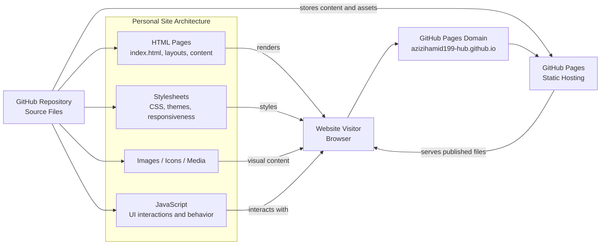

# Architecture Overview

This repository hosts a static personal website served through GitHub Pages. The architecture is intentionally simple and reliable, with content stored in the GitHub repository and published automatically via GitHub Pages.

## Overview

- Source content lives in the GitHub repository.
- GitHub Pages publishes the static site to the public domain.
- The browser requests the page through the GitHub Pages endpoint.
- HTML, CSS, JavaScript, and media assets are delivered as static files.
- This architecture is ideal for a portfolio, personal landing page, or lightweight content site with no backend required.
